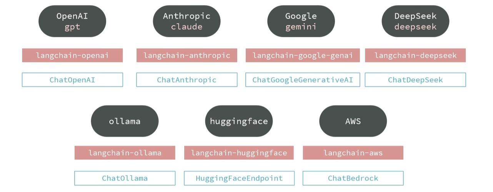

# 07-LangChain入门-初始化模型

- **模型（Models）**

LangChain支持现在市面上大部分常见的大语言模型（LLM），并且提供了各个模型的对应依赖库



如果想要调用某个模型，即导入对应的包，然后创建模型即可实现，例子如下（gpt为例）

```python
from langchain_openai import ChatOpenAI
model = ChatOpenAI(model="gpt-5.2")
```

以上是旧版的引入方式，比较繁琐

新版的引入方式如下（不需要导入任何大语言模型服务商提供的类，而是直接通过你所创建的模型自己去推断想要使用的提供商，它就会帮助我们引入ChatOpenAI，并创建Agent对象）：

```python
from langchain.chat_models import init_chat_model
model = init_chat_model(model="gpt-5.2")
```

我们以deepseek为例，要用这个模型

开发步骤：

1. 引入依赖

```
uv add langchain
uv add langchain-deepseek
```

2. 配置环境

```
DEEPSEEK_API_KEY=sk-xxx
```

3. 初始化模型

```
# 旧版
from langchain_openai import ChatOpenAI
model = ChatDeepSeek(model = "deepseek-chat")
# 新版
from langchain.chat_models import init_chat_model
model = init_chat_model(model="deepseek-chat")
```


**演示模型的使用和初始化**

1. 初始化并调用模型

LangChain提供了两种常见函数用来初始化模型：

- 使用init_chat_model函数，由LangChain自动创建模型对象
- 使用不同模型对应的类，手动创建模型对象

1.1-init_chat_model

官方推荐的方式是使用init_chat_model函数。

使用init_chat_model函数，你需要从LangChain支持的模型提供者（Model Provider）中选择一个模型。而LangChain根据模型名称自动初始化与模型的连接，非常方便。

接下来，我们要做的操作：

- 安装模型依赖：uv add langchain langchain-deepseek
- 在.env中配置模型的api_key
- 调用init_chat_model函数，传入正确的模型名称


代码如下：

```
from dotenv import load_dotenv
load_dotenv()

# 导入LangChain的初始化模型的函数
from langchain.chat_models import init_chat_model

# 调用init_chat_model函数初始化模型
# 参数model用来指定模型名称，LangChain会根据模型名字自动设定base_url，并从环境变量中获取api_key
model = init_chat_model(model = "deepseek-chat")
```


2. 自定义模型提供商

init_chat_model默认会根据模型名称自动确定模型的提供者的base_url，并从env读取api_key，但前提必须是LangChain支持的平台模型，例如：

- openai
- deepseek
- ...

对于其他模型，我们必须自定义模型参数来访问

例如，我们要访问阿里云百炼的qwen-max，它就是不被langchain支持的模型，我们必须自定义模型参数来访问。

- 我们需要在环境变量中定义api_key和base_url
- 然后在init_chat_model中指定model、model_provider、base_url和api_key

代码如下：

```
# 我们收到加载环境变量中的base_url和api_key
import os

base_url = os.getenv("DASHSCOPE_BASE_URL")
api_key = os.getenv("DASHSCOPE_API_KEY")

model = init_chat_model(
    model = "qwen-max", # 模型名称，可以自定义
    model_provider = "openai", # 如果是LangChain不支持的模型，需要指定模型提供者（虽然我们用的是阿里，但是阿里兼容openai，所以这里用openai）
    base_url = base_url,
    api_key = api_key
)

print(type(model))
```

运行结果：

```
<class 'langchain_openai.chat_models.base.ChatOpenAI'>
```


**调整模型参数**

除了修改模型提供者以外，init_chat_model函数允许我们调整模型参数，例如：

- temperature：控制生成文本的随机性，值越小越确定，值越大越随机
- max_tokens：控制生成文本的最大长度
- top_p：控制生成文本的多样性，值越小越多样，值越大越确定
- timeout：控制生成文本的超时时间
- max_retries：控制生产文本的最大重试次数
- ...

```
# 调用init_chat_model函数初始化模型，并设定模型参数
model = init_chat_model(
    model = "qwen-max",
    model_provider = "openai",
    base_url = base_url,
    api_key = api_key,
    temperature = 1.5,
    top_p = 0.9,
)

print(type(model))
```

运行结果如下：

```
<class 'langchain_openai.chat_models.base.ChatOpenAI'>
```


**使用Model类**

我们使用社区版本的Model类来访问阿里云百炼的通义千问模型：

1. 我们需要安装依赖LangChain社区依赖和阿里云百炼依赖

```
uv add langchain-community dashscope
```

代码如下：

```
from langchain_community.chat_models.tongyi import ChatTongyi

# 使用Model类初始化模型
model = ChatTongyi(
    model = "qwen-max"
    # 其他模型参数...
)
print(type(model))
```

运行结果：

```
<class 'langchain_community.chat_models.tongyi.ChatTongyi'>
```

